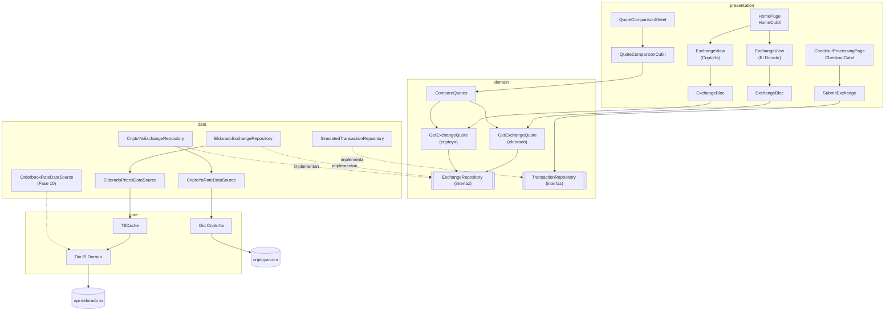
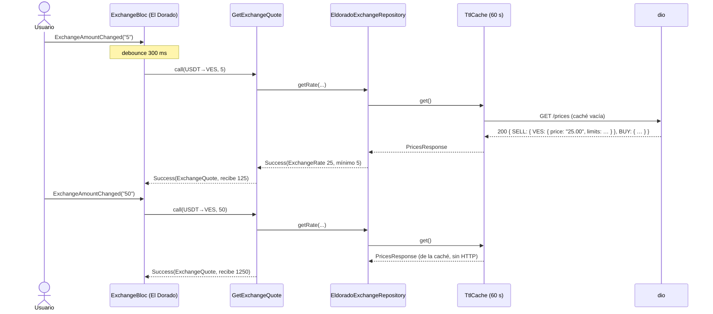
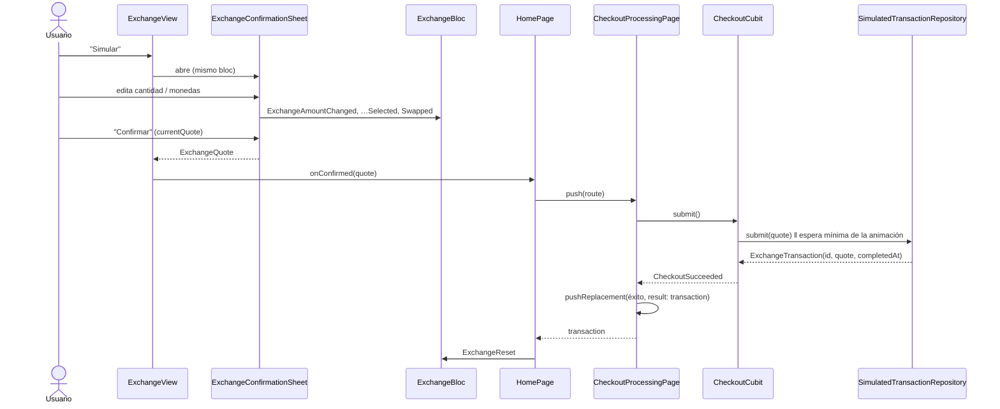

# Arquitectura: calculadora de cambio

> Estado: propuesta · Última actualización: 2026-11-16
> Documentos relacionados: [IMPLEMENTATION_PLAN.md](IMPLEMENTATION_PLAN.md) · [API_RESEARCH.md](API_RESEARCH.md) · [DESIGN_SYSTEM.md](DESIGN_SYSTEM.md)

## 1. Contexto

Mini-app Flutter que calcula cuánto recibe el usuario al cambiar un monto entre una moneda **crypto** y una **fiat**.

- **Home con dos pestañas.** Ambas tienen la misma calculadora, cada una con su fuente de tasas:
  - **El Dorado:** `GET https://api.eldorado.io/api/prices`, el API público oficial. Es el precio de su libro P2P.
  - **CriptoYa:** `GET https://criptoya.com/api/{coin}/{fiat}/1`. Es la mediana de los exchanges P2P que agrega.
- **Comparación de cotizaciones.** Muestra lado a lado lo que se recibe con cada proveedor para el mismo par y monto, y permite saltar a la pestaña más conveniente.

El endpoint del README (`orderbook/public/recommendations`) responde `404` porque la ruta fue eliminada. Queda como fuente alternativa para la pestaña El Dorado (Fase 10 del plan). El detalle de las tres APIs está en [API_RESEARCH.md](API_RESEARCH.md).

El diseño de referencia está en `assets/screen_1.jpg` (calculadora), `assets/sheet_1.jpg` (selector FIAT) y `assets/sheet_2.jpg` (selector Cripto). Las pestañas y la comparación no están en el diseño; se construyen con sus mismos tokens.

### Objetivos de la arquitectura

1. **Fidelidad al diseño.** La estructura, las medidas y la tipografía salen de los mocks; la paleta es la de El Dorado. Todo vive en un design system de tokens ([DESIGN_SYSTEM.md](DESIGN_SYSTEM.md)).
2. **Calidad y mantenibilidad.** Capas con responsabilidades claras. La lógica de negocio es Dart puro y tiene pruebas.
3. **Escalabilidad.** Agregar un proveedor, una moneda o una funcionalidad no obliga a tocar el resto. Un proveedor nuevo aparece solo como pestaña y en la comparación.
4. **Independencia de las APIs.** La fuente de cada proveedor se cambia con configuración, no con código. Las pruebas reemplazan cada API por una falsa en el borde HTTP y corren sin red; la app no incluye datos simulados.

### Fuera de alcance

Autenticación, ejecución real del cambio (se simula detrás de `TransactionRepository`, §10), persistencia e historial.

## 2. Decisiones clave

| # | Decisión | Alternativas descartadas | Motivo |
|---|---|---|---|
| D1 | Organización por *feature* (`home`, `exchange`, `quote_comparison`, `checkout`) con capas `domain` / `data` / `presentation` | Por capa técnica, MVC | La feature es la unidad de crecimiento; las capas aíslan el dominio de Flutter y de las APIs. |
| D2 | **Un `ExchangeRepository` por proveedor**, identificado por `RateProvider`. `ExchangeBloc` no sabe de qué proveedor se trata. | Un repositorio con un *flag*; el proveedor elegido globalmente por configuración | Las dos pestañas reutilizan la misma UI y el mismo bloc con estado independiente, y la comparación necesita ambos proveedores a la vez. |
| D3 | **Tasas independientes del monto y cacheadas** (El Dorado 60 s, CriptoYa 30 s por par), con una sola petición en curso | Una petición por cada cambio del monto | Lo que se recibe se calcula al instante, se respetan los límites de uso de las APIs, y la pestaña y la comparación muestran los mismos números. |
| D4 | La comparación es una feature aparte que depende solo del **dominio** de `exchange` | Implementarla dentro de la calculadora | Se puede probar y quitar por separado, y la calculadora no crece. |
| D5 | `flutter_bloc`: **Bloc** para la calculadora; **Cubit** para el estado simple (pestaña activa, comparación) | Riverpod, Provider; todo con Cubit | Los *transformers* del Bloc (`debounce`, `restartable`, `droppable`) resuelven la concurrencia de la calculadora; donde no hay concurrencia, un Cubit es más simple. |
| D6 | Clases `sealed` de Dart 3 para estados, `Result` y `Failure` | `freezed` + `build_runner` | *Pattern matching* exhaustivo sin generación de código. |
| D7 | `Decimal` (paquete `decimal`) para montos y tasas | `double` | Evita errores de punto flotante con dinero. |
| D8 | APIs falsas **en el borde HTTP**, solo en las pruebas: un interceptor de `dio` por proveedor | Repositorios falsos; un modo de datos simulados en la app | Las pruebas corren el mismo código que la app: URL, parseo, caché y mapeo de errores. La app solo habla con las APIs reales (hasta la Fase 12 tenía un modo `USE_MOCK`). |
| D9 | Catálogo de monedas local | Pedirlo a las APIs | Ninguna de las dos expone nombres ni símbolos. El catálogo de El Dorado (`/stage/currencies`) marca VES y USDC como deshabilitadas. Un único archivo define las 8 monedas del diseño. |
| D10 | `get_it` como *composition root*, con una instancia por proveedor (`instanceName`) | Inyección manual, `injectable` | Simple y sin codegen; un solo lugar arma las dependencias según la configuración. |
| D11 | Textos en ARB (`flutter gen-l10n`), locale `es` | Strings en el código | Permite sumar idiomas sin refactor. |
| D12 | Design system propio (`core/design_system`): paleta de El Dorado, tokens semánticos como `ThemeExtension` y componentes `Ds*` | Colores y estilos sueltos en cada widget | Un solo lugar define la marca; el contraste se verifica con pruebas; sumar un tema oscuro no toca los widgets. |
| D13 | La confirmación edita el **mismo `ExchangeBloc`** de la pestaña; la ejecución es una feature aparte (`checkout`) con un `TransactionRepository` simulado | Un estado propio para el sheet; ejecutar dentro de `exchange` | Lo que se edita al confirmar queda en la calculadora sin sincronizar dos estados; cambiar la simulación por un API real no toca la UI. |

## 3. Vista general

Regla de dependencias: `presentation → domain ← data`. El dominio es Dart puro: no importa Flutter, `dio` ni nada de `data`. `quote_comparison` y `checkout` solo dependen del dominio de `exchange`; `home` las compone.



## 4. Estructura de carpetas

```
lib/
├── main.dart                                   # lee AppConfig y llama a bootstrap
├── bootstrap.dart                              # rootApp: configuración, DI y runApp
├── app/
│   ├── app.dart                                # MaterialApp: tema, l10n, home
│   ├── config_error_app.dart                   # pantalla si falta el .env
│   └── di/injection.dart                       # Dio, data source, repositorio y GetExchangeQuote por RateProvider
├── core/
│   ├── config/app_config.dart                  # claves de --dart-define (§7)
│   ├── network/dio_factory.dart                # un Dio por proveedor; timeouts; logging solo en debug
│   ├── cache/ttl_cache.dart                    # caché con TTL que comparte la petición en curso
│   ├── error/failure.dart                      # sealed Failure
│   ├── error/result.dart                       # sealed Result<T>
│   ├── formatting/amount_formatter.dart        # Decimal → "125.00"; porcentajes con signo
│   └── design_system/                          # tokens, tema y componentes Ds* (DESIGN_SYSTEM.md)
├── l10n/
│   ├── app_es.arb
│   └── l10n_extensions.dart                    # textos derivados del dominio (proveedores, errores)
└── features/
    ├── home/presentation/
    │   ├── cubit/home_cubit.dart               # pestaña activa (RateProvider)
    │   ├── pages/home_page.dart                # crea los ExchangeBloc; fondo por pestaña, checkout
    │   └── widgets/provider_tabs.dart          # una pestaña por RateProvider.values
    ├── exchange/
    │   ├── domain/
    │   │   ├── catalog/currency_catalog.dart   # las 8 monedas del diseño; fiat ordenadas por país
    │   │   ├── entities/                       # currency, exchange_pair, exchange_rate, exchange_quote,
    │   │   │                                   # rate_provider, pair_availability
    │   │   ├── repositories/exchange_repository.dart
    │   │   └── usecases/get_exchange_quote.dart
    │   ├── data/
    │   │   ├── common/                         # exchange_rate_data_source, exchange_rate_model,
    │   │   │                                   # data_exceptions, map_data_exception
    │   │   ├── eldorado/                       # eldorado_prices_data_source, prices_response,
    │   │   │                                   # eldorado_exchange_repository, eldorado_currency_ids
    │   │   ├── criptoya/                       # criptoya_rate_data_source, criptoya_response,
    │   │   │                                   # criptoya_exchange_repository
    │   │   └── orderbook/                      # Fase 10: orderbook_rate_data_source,
    │   │                                       # recommendation_response
    │   └── presentation/
    │       ├── bloc/                           # exchange_bloc, exchange_event, exchange_state
    │       ├── views/exchange_view.dart        # la calculadora (una por pestaña)
    │       ├── views/currency_selection.dart   # abre los selectores y aplica la moneda al bloc
    │       └── widgets/                        # ver §8.4; incluye exchange_confirmation_sheet
    │                                           # y confirmation_fields (las tres filas)
    └── quote_comparison/
        ├── domain/
        │   ├── entities/quote_comparison.dart
        │   └── usecases/compare_quotes.dart
        └── presentation/
            ├── cubit/quote_comparison_cubit.dart
            └── widgets/                        # quote_comparison_sheet, provider_quote_card
    └── checkout/
        ├── domain/                             # exchange_transaction, transaction_repository,
        │                                       # submit_exchange
        ├── data/simulated_transaction_repository.dart
        └── presentation/
            ├── cubit/checkout_cubit.dart
            ├── pages/                          # checkout_processing_page, checkout_success_page
            └── widgets/                        # processing_animation, processing_steps,
                                                # success_mark, receipt_card
test/                                           # misma estructura que lib/
├── fixtures/eldorado/                          # respuestas reales capturadas y casos borde
├── fixtures/criptoya/
└── live/                                       # contratos contra las APIs reales (LIVE_TESTS=true)
```

## 5. Dominio

### 5.1 Entidades

```dart
enum CurrencyType { fiat, crypto }

final class Currency extends Equatable {
  final String code;        // 'USDT', 'VES': lo usan /api/prices y CriptoYa
  final String name;        // 'Tether', 'Bolívares'
  final String symbol;      // 'USDT', 'Bs'
  final CurrencyType type;
  final String? iconAsset;  // ruta del asset; null → avatar con iniciales
  final String? country;    // país de una fiat; ordena el selector FIAT
}

enum RateProvider { eldorado, criptoya } // el orden define el de las pestañas

enum ExchangeDirection { cryptoToFiat, fiatToCrypto }

final class ExchangePair extends Equatable {
  // Invariante: un lado es crypto y el otro fiat. Si no, lanza ArgumentError.
  final Currency from;      // TENGO (moneda del monto ingresado)
  final Currency to;        // QUIERO
  ExchangeDirection get direction;
  Currency get crypto;
  Currency get fiat;
  ExchangePair swapped();
  ExchangePair withFrom(Currency currency);
  ExchangePair withTo(Currency currency);
}

final class ExchangeRate extends Equatable {
  final Decimal fiatPerCrypto;
  final Decimal? minAmount;       // en la moneda de TENGO; null si la fuente no lo informa
  final Duration? estimatedTime;  // null → la UI oculta la fila
  final int? sampleSize;          // CriptoYa: cuántos exchanges entraron en la mediana
}

final class ExchangeQuote extends Equatable {
  final RateProvider provider;
  final ExchangePair pair;
  final Decimal amount;           // en la moneda `from`
  final ExchangeRate rate;
  final Decimal receiveAmount;    // en la moneda `to`
}

final class PairAvailability {
  const PairAvailability.unknown(); // la fuente no lo sabe de antemano: todo habilitado
  bool isAvailable(ExchangePair pair);
}
```

> `iconAsset` en una entidad es una concesión pragmática: es solo un `String` y no acopla el dominio a Flutter. Los IDs propios de cada API (por ejemplo, `TATUM-TRON-USDT`) no están en el dominio: los traduce cada *data source*.

### 5.2 Reglas de conversión (`GetExchangeQuote`)

| TENGO | QUIERO | Recibirás |
|---|---|---|
| Crypto | Fiat | `amount × fiatPerCrypto` |
| Fiat | Crypto | `amount ÷ fiatPerCrypto` |

- La división usa precisión de 8 decimales. El monto a recibir se **trunca** a 2 decimales al mostrarlo, para no prometer más de lo que el usuario obtendrá.
- Si la tasa es `≤ 0` → `InvalidRateFailure`.
- Si `minAmount` existe y el monto es menor → `BelowMinimumFailure(minAmount)`.
- "Tasa estimada" se muestra siempre como fiat por 1 crypto (`≈ 25.00 VES`), en ambas direcciones.

```dart
abstract interface class ExchangeRepository {
  RateProvider get provider;
  Future<Result<ExchangeRate>> getRate({
    required ExchangePair pair,
    required Decimal amount,      // las fuentes actuales no lo usan; el API de órdenes sí
    bool forceRefresh = false,    // invalida la caché
  });
  Future<PairAvailability> getAvailability();
}

final class GetExchangeQuote {
  GetExchangeQuote(this._repository);
  Future<Result<ExchangeQuote>> call(
    ExchangePair pair,
    Decimal amount, {
    bool forceRefresh = false,
  });
}
```

Los casos de uso existen donde hay lógica de negocio. La disponibilidad de pares es un paso directo, así que `ExchangeBloc` la consulta en el repositorio sin un caso de uso intermedio.

## 6. Datos

### 6.1 Proveedores

```dart
abstract interface class ExchangeRateDataSource {
  /// Lanza una ExchangeDataException; el repositorio la traduce a Failure.
  Future<ExchangeRateModel> fetchRate({
    required ExchangePair pair,
    required Decimal amount,
    bool forceRefresh = false,
  });
}
```

| `RateProvider` | *Data source* | Repositorio | Cobertura |
|---|---|---|---|
| `eldorado` | `EldoradoPricesDataSource` (por defecto) u `OrderbookRateDataSource` (Fase 10, `ELDORADO_SOURCE=orderbook`) | `EldoradoExchangeRepository` | Solo USDT. VES solo crypto→fiat. Sin USDC. |
| `criptoya` | `CriptoYaRateDataSource` | `CriptoYaExchangeRepository` | USDT y USDC × 6 fiat; según el par puede no haber ofertas. |

Ambos repositorios comparten el mapeo de excepciones a `Failure` (`map_data_exception.dart`, §6.4).

### 6.2 El Dorado: `GET {ELDORADO_API_URL}/prices`

Sin parámetros ni autenticación, con CORS `*`. Una sola respuesta trae todas las fiat en las dos direcciones:

```json
{
  "SELL": { "VES": { "limits": { "in": { "min": "5" }, "out": { "min": "5074.146" } }, "price": "1014.8292" } },
  "BUY":  { "BRL": { "limits": { "in": { "min": "29.985" }, "out": { "min": "5" } }, "price": "5.997" } }
}
```

| Dirección | Lado | `fiatPerCrypto` | `minAmount` (en TENGO) |
|---|---|---|---|
| crypto→fiat (vender USDT) | `SELL` | `SELL[fiat].price` | `SELL[fiat].limits.in.min` (USDT) |
| fiat→crypto (comprar USDT) | `BUY` | `BUY[fiat].price` | `BUY[fiat].limits.in.min` (fiat) |

- **`PricesResponse`:**
  - `price` acepta string o número; `limits` es opcional.
  - Si el lado o la fiat no existen, o la crypto no es USDT → `UnsupportedPairException`.
- **`estimatedTime`:** 10 min fijos, el valor del diseño, porque `/api/prices` no lo informa.
- **`getAvailability()`:** se calcula con la respuesta cacheada, a partir de los pares que existen en cada lado. Los sheets de esa pestaña lo usan para ocultar las monedas que no cotiza.
- **Precios:** son **indicativos, no vinculantes**, según la documentación de El Dorado.

### 6.3 CriptoYa: `GET {CRIPTOYA_API_URL}/{coin}/{fiat}/1`

Sin autenticación, con CORS `*` y un límite de `x-ratelimit-limit: 120`. `coin` y `fiat` van en minúsculas.

```json
{ "binancep2p": { "ask": 1047.495, "totalAsk": 1047.495, "bid": 1052, "totalBid": 1052, "time": 1794595489 },
  "bybitp2p":   { "ask": 0,        "totalAsk": 0,        "bid": 1045, "totalBid": 1045, "time": 1794595494 } }
```

| Dirección | `fiatPerCrypto` |
|---|---|
| crypto→fiat (vender) | mediana de `totalBid` entre los exchanges con valor mayor que 0 |
| fiat→crypto (comprar) | mediana de `totalAsk` entre los exchanges con valor mayor que 0 |

- **Mediana, no mejor precio:** los extremos del libro P2P son ruidosos y a veces aparecen invertidos (bid > ask).
- **`sampleSize`:** cuántos exchanges entraron en la mediana; se muestra en la UI.
- **Sin ofertas:** si ningún exchange tiene un valor mayor que 0 → `NoOffersException`.
- **Volumen 1:** se pide con volumen 1, así que la tasa no depende del monto. No informa mínimo ni tiempo estimado (`null`).
- **`getAvailability()`:** devuelve `PairAvailability.unknown()`; la falta de ofertas se informa al cotizar.

### 6.4 Repositorio y errores

Los repositorios capturan las excepciones y devuelven `Result<ExchangeRate>`. Los mensajes viven en la capa de presentación (ARB), no en `data`.

| Origen | `Failure` | Mensaje en UI |
|---|---|---|
| `DioExceptionType.connectionError` | `NetworkFailure` | Sin conexión. Revisa tu internet. |
| `connectionTimeout` / `receiveTimeout` | `TimeoutFailure` | El servicio tardó demasiado. Intenta de nuevo. |
| HTTP 429 | `ServerFailure(429)` | Demasiadas consultas. Espera un momento. |
| Otro HTTP 4xx / 5xx | `ServerFailure(statusCode)` | No pudimos obtener la tasa. |
| `UnsupportedPairException` | `PairUnavailableFailure(provider)` | Este par no está disponible en {proveedor}. |
| `NoOffersException` | `NoOffersFailure` | No hay ofertas para este par. Prueba con otro par o monto. |
| `ApiErrorException` (Fase 10) | `InvalidRequestFailure(code)` | No pudimos obtener la tasa. |
| `ParsingException` | `ParsingFailure` | Recibimos una respuesta inesperada. |
| Tasa `≤ 0` (dominio) | `InvalidRateFailure` | No pudimos obtener la tasa. |
| Monto bajo el mínimo (dominio) | `BelowMinimumFailure(min)` | Mínimo {min} {código}. |
| Otro | `UnknownFailure` | Algo salió mal. Intenta de nuevo. |

### 6.5 Caché (`TtlCache`)

`TtlCache<K, V>` (en `core/cache`) envuelve cada petición:

- **TTL:** El Dorado cachea una sola entrada (toda la respuesta de `/prices`) durante 60 s. CriptoYa cachea una entrada por `(coin, fiat)` durante 30 s, igual que su `cache-control: max-age=30`.
- **Petición en curso compartida:** si llegan varias llamadas mientras una petición está en vuelo, todas esperan el mismo `Future`.
- **Fallos:** un error no se cachea.
- **`forceRefresh`:** invalida la entrada. Lo usan "Reintentar", la vuelta de la app al primer plano y el refresco de la comparación.

Como la pestaña y la comparación comparten la caché de cada proveedor, ven exactamente la misma tasa.

### 6.6 APIs falsas en las pruebas

La app no tiene datos simulados: siempre consulta las APIs reales. Las pruebas, en cambio, no salen a la red. `configureDependencies(getIt, config, httpInterceptors: …)` agrega interceptores al `Dio` de cada proveedor, y `test/helpers/fake_apis/` tiene uno por API. Cada uno responde con **la forma real** de su API, así que el parseo, la caché y el mapeo de errores se prueban con el mismo código que usa la app. `fakeApiDependencies()` arma la app completa sobre ellos.

| API falsa | Responde a | Escenarios | Datos |
|---|---|---|---|
| `FakeEldoradoPricesApi` | `GET …/prices` | `success`, `empty`, `serverError`, `timeout`, `malformed` | `FakePrices`. `SELL` VES = 25.00 (valor del diseño: 5 USDT → 125.00 VES); `BUY = SELL × 1.02`; mínimo 5 USDT. Misma cobertura que el real: sin USDC y sin VES en `BUY`. |
| `FakeCriptoYaApi` | `GET …/{coin}/{fiat}/{volumen}` | `success`, `noOffers`, `rateLimited` (429), `serverError`, `timeout`, `malformed` | 4 exchanges: tres alrededor del valor objetivo y uno en 0. `bid` = `SELL` de El Dorado × 1.01 y `ask` = `BUY` × 1.01, así la comparación tiene un ganador distinto según la dirección. VES `ask` = 25.75; USDC = USDT × 0.998. |
| `FakeOrderbookApi` (Fase 10) | `GET …/orderbook/public/recommendations` | `success`, `noOffers`, `invalidRequest`, `serverError`, `timeout`, `malformed` | Forma documentada en [API_RESEARCH.md §2](API_RESEARCH.md#2-forma-del-response-de-recommendations). |

### 6.7 API de órdenes (Fase 10)

Si el equipo entrega una URL vigente de `recommendations`, `ELDORADO_SOURCE=orderbook` hace que la pestaña El Dorado use `OrderbookRateDataSource` contra `API_URL`. Con eso:

- La tasa pasa a ser una oferta concreta que depende del monto.
- El tiempo estimado sale de `offerMakerStats.marketMakerOrderTime`.
- `data: {}` se traduce en `NoOffersException` y `error` en el body en `ApiErrorException`.
- La forma de la respuesta y los IDs de moneda (`TATUM-TRON-USDT`, `TATUM-MATIC-USDC`) están en [API_RESEARCH.md §2–3](API_RESEARCH.md#2-forma-del-response-de-recommendations). Los IDs viven en `data/eldorado/eldorado_currency_ids.dart`.

La pestaña, el bloc y la comparación no cambian. Sin `API_URL`, la app vuelve a `/api/prices` y lo avisa en el log.

## 7. Configuración por entorno

`AppConfig` la lee con `String.fromEnvironment`. Los valores viven en `.env` (no versionado; las claves están en `.env.example`) y se pasan con `--dart-define-from-file=.env`; un `--dart-define` suelto pisa el valor del archivo. El código no tiene URLs. Si la app se ejecuta sin el `.env`, `rootApp` (en `bootstrap.dart`) no arma las dependencias: muestra `ConfigErrorApp`, con las claves que faltan y el comando para ejecutarla, y deja `MissingConfigException` en la consola. Sin esa pantalla, la app quedaría en el splash. Las pruebas no lo necesitan: usan URLs de mentira y APIs falsas.

| Clave | Obligatoria | Efecto |
|---|---|---|
| `ELDORADO_API_URL` | Sí | URL base de `/prices` |
| `CRIPTOYA_API_URL` | Sí | URL base de CriptoYa |
| `ELDORADO_SOURCE` | No (`prices`) | `orderbook` para usar el API de órdenes (Fase 10) |
| `API_URL` | No | endpoint `recommendations` (Fase 10) |

Cómo arma `injection.dart` cada proveedor:

| `RateProvider` | `Dio` | *Data source* | API falsa en las pruebas |
|---|---|---|---|
| `eldorado` | `ELDORADO_API_URL` (o `API_URL` con `orderbook`) | `EldoradoPricesDataSource` u `OrderbookRateDataSource` según `ELDORADO_SOURCE` | `FakeEldoradoPricesApi` u `FakeOrderbookApi` |
| `criptoya` | `CRIPTOYA_API_URL` | `CriptoYaRateDataSource` | `FakeCriptoYaApi` |

Cada repositorio y su `GetExchangeQuote` se registran con `instanceName: provider.name`. `CompareQuotes` recibe un `Map<RateProvider, GetExchangeQuote>` con todos.

```bash
flutter run --dart-define-from-file=.env                        # APIs reales
flutter run --dart-define-from-file=.env --dart-define=ELDORADO_SOURCE=orderbook --dart-define=API_URL=<url>   # Fase 10
```

## 8. Presentación

### 8.1 Estado de la calculadora

Cada pestaña tiene su propia instancia de `ExchangeBloc`. El bloc recibe por constructor el `GetExchangeQuote` y el `ExchangeRepository` de su proveedor, sin saber cuál es.

```dart
final class ExchangeState extends Equatable {
  final ExchangePair pair;               // inicial: USDT → BOB (una sola constante)
  final Decimal? amount;                 // null si está vacío o es inválido
  final QuoteStatus quote;
  final PairAvailability availability;   // para ocultar monedas en los sheets
  bool get canSubmit => currentQuote != null; // cotización del par y monto actuales
}

sealed class QuoteStatus {}
final class QuoteIdle extends QuoteStatus {}                              // sin monto
final class QuoteLoading extends QuoteStatus { ExchangeQuote? previous; }  // conserva el valor anterior
final class QuoteLoaded extends QuoteStatus { ExchangeQuote quote; }
final class QuoteFailed extends QuoteStatus { Failure failure; }
```

### 8.2 Eventos y concurrencia

| Evento | Lo dispara | Efecto |
|---|---|---|
| `ExchangeAmountChanged(text)` | `AmountField` | Actualiza `amount` al instante y cotiza con *debounce* de 300 ms. |
| `ExchangeFromCurrencySelected(c)` | Selector TENGO | Cambia `from` y cotiza de inmediato. |
| `ExchangeToCurrencySelected(c)` | Selector QUIERO | Cambia `to` y cotiza de inmediato. |
| `ExchangeCurrenciesSwapped` | `SwapButton` | Invierte el par, conserva el monto y cotiza. |
| `ExchangePrefilled(pair, amount)` | Comparación ("Usar {proveedor}") | Reemplaza el par y el monto y cotiza. |
| `ExchangeRatesRefreshed` | "Reintentar"; la app vuelve al primer plano | Cotiza con `forceRefresh: true`. |
| `ExchangeReset` | El cambio se completó (§10) | Vuelve al par inicial sin monto, conserva la disponibilidad y descarta cualquier cotización en curso. |

"Simular" no es un evento: abre la confirmación (§10), que edita el bloc con los mismos eventos de esta tabla.

- **Un solo *handler* para cotizar:** todas las cotizaciones pasan por un *handler* interno con `restartable()`. Si llega una petición nueva, la anterior se descarta y nunca se muestra una respuesta obsoleta.
- **El *debounce* vive en ese mismo *handler*:** el evento interno trae un retardo (300 ms al escribir, 0 al cambiar de par); el *handler* espera y, si mientras tanto llegó otro evento (`emit.isDone`), termina sin consultar. Con un *transformer* de *debounce* separado habría dos *handlers* concurrentes y una respuesta vieja podría pisar a una nueva.
- **Por qué se mantiene el *debounce*:** con las fuentes actuales la tasa sale de la caché, así que escribir no genera peticiones HTTP. Se mantiene porque, con el API de órdenes, la tasa sí depende del monto.



### 8.3 Home y pestañas

- **`HomeCubit`:** guarda la pestaña activa (`RateProvider`).
- **`HomePage`:**
  - Crea un `ExchangeBloc` por `RateProvider` y los guarda en un `Map<RateProvider, ExchangeBloc>`.
  - Como hay dos blocs del mismo tipo, no se buscan por tipo en el árbol: cada pestaña se envuelve con su `BlocProvider.value`.
  - Los blocs viven en `HomePage` y las pestañas van en un `IndexedStack`, así cada una conserva su monto y su par al cambiar de una a otra.
- **`ProviderTabs`:** se genera desde `RateProvider.values`, de modo que un proveedor nuevo agrega su pestaña solo.
- **Fondo:** el semicírculo del fondo cambia de color según la pestaña (`HomePage.decorationColorOf`: amarillo para El Dorado, verde para CriptoYa) con una transición animada.
- **Cambio confirmado:** `ExchangeView` avisa con `onConfirmed(quote)`; `HomePage` abre el procesamiento (§10) y, si la ruta devuelve la transacción, envía `ExchangeReset` al bloc de ese proveedor.
- **"Usar {proveedor}" en la comparación:** `HomePage` cambia de pestaña (`HomeCubit`) y envía `ExchangePrefilled(pair, amount)` al bloc de destino.

### 8.4 Árbol de widgets

```
HomePage                                    # HomeCubit + Map<RateProvider, ExchangeBloc>
└── Scaffold (fondo: token background)
    └── Stack
        ├── ExchangeBackground              # semicírculo amarillo (CustomPainter)
        └── SafeArea → Column
            ├── ProviderTabs                # "El Dorado" | "CriptoYa"
            └── Expanded → Stack                # pestañas superpuestas con fundido
                ├── BlocProvider.value(eldorado) → ExchangeView
                └── BlocProvider.value(criptoya) → ExchangeView

ExchangeView
└── Align(topCenter) + AppLayout.calculatorTopInset → ConstrainedBox(maxWidth: 400) → Column
    │                                       # anclada arriba: misma posición en ambas pestañas
    ├── Text("Calculadora")                 # header, alineado con el borde de la tarjeta
    ├── ExchangeCard
    │   ├── CurrencyPairSelector            # píldora con etiquetas TENGO / QUIERO en el borde
    │   │   ├── CurrencySelectorButton (TENGO)  → abre CurrencyPickerSheet
    │   │   ├── SwapButton                       # círculo amarillo, gira al tocarlo
    │   │   └── CurrencySelectorButton (QUIERO) → abre CurrencyPickerSheet
    │   ├── AmountField                     # prefijo con el código en amarillo; mínimo debajo
    │   ├── QuoteSummary                    # QuoteRow × 3 (sin tiempo → 2) | skeleton | QuoteError
    │   └── PrimaryButton("Simular")    # → ExchangeConfirmationSheet
    ├── SourceCaption                       # "Fuente: El Dorado · tasa indicativa"
    └── CompareQuotesLink                   # "Comparar cotizaciones" → QuoteComparisonSheet

CurrencyPickerSheet (showModalBottomSheet)
├── handle + título ("FIAT" | "Cripto")
└── CurrencyListTile × n                    # avatar, código, nombre (símbolo), radio;
                                            # solo las disponibles según PairAvailability
                                            # (la elegida se muestra siempre)

ExchangeConfirmationSheet (showDsBottomSheet, BlocProvider.value del bloc de la pestaña)
├── título "Confirma tu cambio" + subtítulo
├── ConfirmationFields                      # 3 filas: moneda que entregas | moneda que recibes
│                                           # ("Invertir") | cantidad (AmountInput + mínimo)
├── detalle: QuoteSummary + "Fuente"        # tasa, recibirás, tiempo
├── QuoteFailureMessage                     # error con "Reintentar"
├── DsPrimaryButton("Confirmar")            # solo con currentQuote
└── DsTextButton("Cancelar")

QuoteComparisonSheet (showModalBottomSheet)
├── encabezado ("5.00 USDT → VES") + actualizar
├── ProviderQuoteCard × N                   # recibirás, tasa, mínimo, fuente; insignia "Mejor opción";
│                                           # estado propio si falla; botón "Usar {proveedor}"
├── resumen ("Con CriptoYa recibes +1.25 VES (+1.00 %)")
└── nota al pie (las fuentes son indicativas y no equivalentes)
```

Cada selector abre la lista del tipo que tiene su lado en ese momento: si TENGO es crypto, muestra "Cripto".

### 8.5 Sistema de diseño

Detallado en [DESIGN_SYSTEM.md](DESIGN_SYSTEM.md). En resumen:

- **Tokens** en `core/design_system/tokens`: paleta primitiva de El Dorado (`AppPalette`), roles semánticos (`AppColors`, un `ThemeExtension` que se lee con `context.colors`), tipografía Rubik medida en los mocks (`AppTypography`), espaciados, radios, tamaños, sombras y movimiento.
- **Regla de marca:** el amarillo (`#FFFF00`) va como relleno con texto y bordes en tinta (`#121211`); nunca como texto ni como borde sobre blanco.
- **Tema:** `AppTheme.light()` traduce los tokens a `ThemeData` para los widgets de Material.
- **Componentes `Ds*`:** botón principal, botón de texto, enlace, pestañas, insignia (marca y éxito), tarjeta, fondo, texto de conversión, bottom sheet, radio, skeleton.
- **Elementos que no están en el diseño** (pestañas, comparación): se construyen solo con estos tokens y componentes.

Los mocks miden 804×1748 px, es decir 402×874 pt a @2x. La UI se compara con ellos en *goldens* de ese tamaño.

## 9. Comparación de cotizaciones

### 9.1 Dominio

```dart
final class QuoteComparison extends Equatable {
  final ExchangePair pair;
  final Decimal amount;
  final Map<RateProvider, Result<ExchangeQuote>> results;
  final RateProvider? best;            // el que entrega más de la moneda QUIERO
  final Decimal? difference;           // best − segundo mejor, en la moneda QUIERO
  final Decimal? differencePercent;    // difference ÷ segundo mejor × 100
}

final class CompareQuotes {
  CompareQuotes(Map<RateProvider, GetExchangeQuote> quoters);
  Future<QuoteComparison> call(
    ExchangePair pair,
    Decimal amount, {
    bool forceRefresh = false,
  });
}
```

- **Paralelo:** ejecuta el `GetExchangeQuote` de cada proveedor con `Future.wait`. Un proveedor que falla no bloquea a los demás; su `Result` queda como `Failure`.
- **`best`:** solo existe si hay al menos un resultado exitoso y no hay empate en el primer puesto.
- **`difference` y `differencePercent`:** solo existen si hay al menos dos resultados exitosos.
- **Precisión:** se calcula con la precisión completa y se trunca solo al mostrar.
- **N proveedores:** funciona con cualquier cantidad. Con dos, "segundo mejor" es simplemente el otro.

### 9.2 Estado y UI

- **`QuoteComparisonCubit`:** `Loading` → `Loaded(QuoteComparison)`; `refresh()` vuelve a comparar con `forceRefresh: true`.
- **Punto de entrada:** `CompareQuotesLink`, debajo de la tarjeta (fuera de ella, para no alterar el diseño). Se habilita con un monto válido y toma el par y el monto de la pestaña activa.
- **Contenido:** cada `ProviderQuoteCard` muestra su resultado o su propio estado de error ("No disponible en El Dorado", "Sin ofertas", error con reintento).
- **"Usar {proveedor}":** cierra el sheet y delega en `HomePage` (§8.3).

## 10. Confirmación y ejecución del cambio



- **Dominio (`checkout/domain`):** `ExchangeTransaction` (ID, cotización, fecha), `TransactionRepository` y `SubmitExchange`, que rechaza cotizaciones sin monto a recibir.
- **Datos:** `SimulatedTransactionRepository` espera una latencia (1.2 s) y aprueba con un ID `TX-XXXX-XXXX` en base32 de Crockford. El reloj y el generador aleatorio se inyectan, así las pruebas y los *goldens* son deterministas. Un API real reemplaza solo esta clase.
- **`CheckoutCubit`:** `Processing(attempt)` → `Succeeded(transaction)` o `Failed(failure)`. Espera la respuesta y la duración de la animación en paralelo (`(a, b).wait`), así una respuesta instantánea no corta los pasos. "Reintentar" incrementa `attempt` y reinicia la animación.
- **Pantalla de proceso:** amarilla y a pantalla completa; `PopScope` impide salir mientras procesa. Muestra el disco de intercambio con ondas y tres pasos que avanzan por tiempo; el último solo se completa con la respuesta.
- **Pantalla de éxito:** reemplaza a la de proceso (así "atrás" vuelve a la calculadora) y completa su ruta con la transacción. Comprobante con lo recibido y lo enviado, tasa, fuente, fecha y hora (formatos de `MaterialLocalizations`), estado e ID copiable.
- **Reinicio:** al recibir la transacción, `HomePage` envía `ExchangeReset` al bloc del proveedor de la cotización. Si se sale desde el error, la ruta devuelve `null` y la calculadora conserva lo ingresado.

## 11. Estrategia de pruebas

| Nivel | Qué cubre | Herramientas |
|---|---|---|
| Unitarias: dominio | `ExchangePair` (invariantes, swap); `GetExchangeQuote` (ambas direcciones, truncado, mínimo, tasa inválida); `CompareQuotes` (ganador por dirección, resultados parciales, empate, ambos fallan) | `test`, repositorios falsos |
| Unitarias: datos | DTOs contra fixtures reales y casos borde; selección de `SELL`/`BUY`; mediana de CriptoYa (valores en 0, libro invertido); `TtlCache` (TTL, petición en curso compartida, `forceRefresh`); cada escenario de las APIs falsas; mapeo de errores | `test`, APIs falsas en `test/helpers/fake_apis` |
| Bloc | *debounce*, descarte de respuestas obsoletas, swap, selección, `ExchangePrefilled`, `ExchangeReset`, mínimo, par no disponible, reintento; `HomeCubit`; `QuoteComparisonCubit`; `CheckoutCubit` (éxito, error y reintento, duración mínima) | `bloc_test` |
| Widgets | Cambiar de pestaña conserva el estado; título sobre la tarjeta y fondo por pestaña; selector FIAT por país; la tarjeta muestra la cotización; los sheets ocultan las monedas no disponibles y se ajustan a la lista; la comparación marca la "Mejor opción" y "Usar {proveedor}" cambia de pestaña con el mismo par y monto; la confirmación edita las tres filas, bloquea "Confirmar" sin cotización vigente y "Cancelar" no confirma; proceso (pasos, sin salida), comprobante (datos, ID copiable), error con reintento; flujo completo con reinicio de la pestaña | `flutter_test` |
| Contrato (`live`) | La forma real de `/api/prices` y de CriptoYa. Excluidas por defecto; se corren con `--dart-define-from-file=.env --dart-define=LIVE_TESTS=true --tags live` | `flutter_test` |
| Visual (opcional) | *Goldens* de ambas pestañas, los selectores, la comparación, la confirmación, el proceso y el comprobante | `flutter_test` |

## 12. Cómo escala

- **Nuevo proveedor:**
  1. Un valor en `RateProvider`.
  2. Un *data source*, su repositorio y su API falsa para las pruebas.
  3. El registro en `injection.dart`.

  Con eso la pestaña y la comparación lo incluyen solas. Pasadas 3–4 pestañas, conviene cambiar `ProviderTabs` por un selector.
- **Nueva moneda:** una entrada en `currency_catalog.dart`, su ícono en `assets/` y sus precios en las APIs falsas de las pruebas.
- **Nueva funcionalidad** (historial, alertas de tasa): una carpeta `features/<nombre>/` con las mismas capas, que dependa solo del dominio de otras features, como `quote_comparison` y `checkout`.
- **Ejecución real:** una implementación HTTP de `TransactionRepository` registrada en `injection.dart`; la confirmación y las pantallas no cambian.
- **Nuevo idioma:** un `app_<locale>.arb`.
- **Más pantallas:** se incorpora `go_router` en `app/`.

## 13. Riesgos y preguntas abiertas

| Tema | Impacto | Mitigación |
|---|---|---|
| `/api/prices` no publica límites de uso ni SLA | Posibles cortes | Caché de 60 s y petición en curso compartida |
| CriptoYa limita las consultas (120) y no tiene términos formales | Posibles 429 | Caché de 30 s por par; mensaje propio para el 429 |
| Las APIs cambian su forma | El parseo falla | DTOs tolerantes y pruebas `live` de contrato |
| El Dorado no cubre USDC ni la compra de USDT con VES | Pares no disponibles en su pestaña | Monedas ocultas en los sheets, mensaje claro y acceso directo a CriptoYa |
| La comparación mezcla dos fuentes distintas (libro propio contra mediana de mercado) | Puede malinterpretarse | Nota al pie en el sheet; ambas se presentan como indicativas |
| La mediana de CriptoYa es ruidosa | Tasa poco representativa en pares con pocas ofertas | Se descartan los 0 y se muestra `sampleSize` |
| Las pestañas y la comparación no están en el diseño | Fidelidad visual | Se construyen con los tokens del diseño y fuera de la tarjeta |
| La ruta `recommendations` fue eliminada | Sin ofertas concretas | Fase 10 opcional: pedirle la URL vigente al equipo |
| Faltan íconos de ARS, BOB y USDC | Detalle visual | `CurrencyAvatar` con iniciales |
| El punto 3 del README está cortado | Requisito incompleto | Se asume que el monto va en la moneda de TENGO, como muestra el diseño |
| La tipografía no está especificada | Fidelidad visual | Rubik, a validar contra los mocks |
