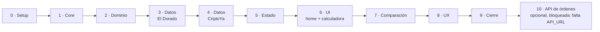

# Plan de implementación

> Estado: propuesta · Última actualización: 2026-11-13
> Documentos relacionados: [ARCHITECTURE.md](ARCHITECTURE.md) · [API_RESEARCH.md](API_RESEARCH.md) · [DESIGN_SYSTEM.md](DESIGN_SYSTEM.md)

## Enfoque

El home tiene **dos pestañas con la misma calculadora**, cada una con su propia fuente de tasas. Una funcionalidad aparte **compara las cotizaciones** de ambas.

| Pestaña | Fuente | Qué es la tasa |
|---|---|---|
| **El Dorado** | `GET https://api.eldorado.io/api/prices` (API pública oficial) | Precio del libro P2P de El Dorado. Es indicativo y solo cubre USDT. |
| **CriptoYa** | `GET https://criptoya.com/api/{coin}/{fiat}/1` | Mediana de los precios de los exchanges P2P que agrega CriptoYa. Cubre USDT y USDC. |

La ruta `orderbook/public/recommendations` del README sigue respondiendo `404`, así que queda como fase opcional (Fase 10). El detalle de ambas APIs está en [API_RESEARCH.md §5](API_RESEARCH.md#5-detalle-de-las-dos-opciones-elegidas).

**Principios:**
1. **Una calculadora, dos proveedores.** Las pestañas reutilizan los mismos widgets y el mismo `ExchangeBloc`; solo cambia el `ExchangeRepository` que recibe cada una (`RateProvider.eldorado` o `RateProvider.criptoya`). Sumar un tercer proveedor es sumar un *data source* y una pestaña.
2. **Las tasas no dependen del monto y se cachean.** El Dorado trae todas las fiat en una llamada (caché de 60 s) y CriptoYa se consulta por par con volumen 1 (caché de 30 s). Escribir el monto no genera peticiones: lo que se recibe se calcula localmente.
3. **Mock en el borde HTTP para cada proveedor.** Con `USE_MOCK=true`, `MockEldoradoPricesInterceptor` y `MockCriptoYaInterceptor` responden con la forma real de cada API. Se usan en las pruebas, para trabajar sin red y para forzar errores por proveedor.
4. **Los huecos de cobertura no se inventan.** El Dorado no tiene USDC ni la compra de USDT con VES; esos pares se muestran como "no disponibles" en su pestaña. CriptoYa los cubre, y la comparación lo deja a la vista.

| Dirección | El Dorado `/api/prices` | CriptoYa | Recibirás |
|---|---|---|---|
| crypto→fiat (vender) | `SELL[fiat].price`; mínimo `SELL[fiat].limits.in.min` (USDT) | mediana de `totalBid > 0` | `monto × tasa` |
| fiat→crypto (comprar) | `BUY[fiat].price`; mínimo `BUY[fiat].limits.in.min` (fiat) | mediana de `totalAsk > 0` | `monto ÷ tasa` |

La tasa siempre se expresa en fiat por 1 crypto. CriptoYa no informa mínimos ni tiempo estimado.

### Módulos

```
lib/features/
├── home/                       # HomePage (2 pestañas), HomeCubit (pestaña activa)
├── exchange/                   # la calculadora, parametrizada por RateProvider
│   ├── domain/                 # entidades, RateProvider, GetExchangeQuote
│   ├── data/
│   │   ├── eldorado/           # EldoradoPricesDataSource, PricesResponse, EldoradoExchangeRepository, MockEldoradoPricesInterceptor
│   │   └── criptoya/           # CriptoYaRateDataSource, CriptoYaResponse, CriptoYaExchangeRepository, MockCriptoYaInterceptor
│   └── presentation/           # ExchangeBloc, ExchangeView, widgets de la tarjeta y los sheets
└── quote_comparison/           # CompareQuotes, QuoteComparison, QuoteComparisonCubit, QuoteComparisonSheet
```

La comparación es una feature aparte que depende solo del **dominio** de `exchange` (`GetExchangeQuote` y las entidades), no de su UI.



Cada fase termina con `flutter analyze` sin issues, `flutter test` en verde y un commit (Conventional Commits).

---

## Fase 0: Setup

**Objetivo:** proyecto Flutter que compila, con el linter y la estructura de carpetas listos.

- [x] `flutter create . --project-name coding_dorado --org <org> --platforms android,ios,web` en el root.
- [x] Revisar con `git diff` que no se hayan sobrescrito `README.md` ni `.gitignore`.
- [x] Agregar dependencias:
  - runtime: `flutter_bloc`, `bloc_concurrency`, `dio`, `get_it`, `equatable`, `decimal`, `intl`, `google_fonts`, `flutter_localizations`
  - dev: `very_good_analysis`, `bloc_test`, `mocktail`
- [x] `analysis_options.yaml` con `very_good_analysis`.
- [x] En `pubspec.yaml`, registrar **solo** `assets/cripto_currencies/` y `assets/fiat_currencies/`. Los `.jpg` de diseño no se empaquetan.
- [x] Configurar l10n: `generate: true`, `l10n.yaml`, `lib/l10n/app_es.arb`.
- [x] Crear la estructura de carpetas (ver [Módulos](#módulos)).
- [x] Reemplazar el contador de ejemplo por un `App` vacío.

**Aceptación:** la app abre en iOS, Android y web; `flutter analyze` sin issues.
**Commit:** `chore: scaffold flutter app`

## Fase 1: Core

**Objetivo:** la infraestructura transversal que usan todas las features.

- [x] `AppConfig` lee estas claves con sus defaults:

  | Clave | Default | Uso |
  |---|---|---|
  | `ELDORADO_API_URL` | `https://api.eldorado.io/api` | URL base de `/prices` |
  | `CRIPTOYA_API_URL` | `https://criptoya.com/api` | URL base de CriptoYa |
  | `USE_MOCK` | `false` | `true` instala los mocks de ambos proveedores |
  | `MOCK_SCENARIO_ELDORADO` | `success` | escenario del mock de El Dorado |
  | `MOCK_SCENARIO_CRIPTOYA` | `success` | escenario del mock de CriptoYa |
  | `MOCK_LATENCY_MS` | `600` | latencia simulada |
  | `ELDORADO_SOURCE` | `prices` | `orderbook` se suma en la Fase 10 |
  | `API_URL` | *(vacío)* | endpoint `recommendations` (Fase 10) |

- [x] `dio_factory.dart`: crea un `Dio` por proveedor (con su URL base), timeouts de 10 s y `LogInterceptor` solo en debug.
- [x] `TtlCache<K, V>` en `core/cache`: TTL por entrada, petición en curso compartida, los errores no se cachean e invalidación con `forceRefresh` ([ARCHITECTURE.md §6.5](ARCHITECTURE.md#65-caché-ttlcache)).
- [x] `Failure` (sealed) y `Result<T>` (sealed, con `map` / `fold`).
- [x] `AmountFormatter`: `Decimal` → `"125.00"`, con truncado para "Recibirás"; formato de porcentajes para la comparación.
- [x] Design system, tokens ([DESIGN_SYSTEM.md](DESIGN_SYSTEM.md)): `AppPalette` con la paleta de El Dorado, `AppColors` (roles semánticos, `ThemeExtension`), `AppTypography` (Rubik, medida en los mocks), `AppSpacing`, `AppRadius`, `AppSizes`, `AppShadows`, `AppMotion` y `AppTheme`.

**Pruebas:** defaults de `AppConfig`; `AmountFormatter` (redondeo, truncado, ceros, valores grandes, porcentajes con signo); `TtlCache` (vencimiento, petición compartida, error no cacheado, `forceRefresh`); contraste WCAG AA de cada par de tokens texto/fondo.
**Commit:** `feat(core): config, networking, errors and design tokens`

## Fase 2: Dominio

**Objetivo:** las reglas de negocio en Dart puro, con pruebas completas.

- [x] Entidades `Currency`, `CurrencyType`, `ExchangeDirection`, `ExchangePair`, `ExchangeRate` y `ExchangeQuote`.
- [x] `RateProvider` (`eldorado`, `criptoya`): identifica la fuente. `ExchangeQuote` incluye el `provider` que la produjo.
- [x] `ExchangeRate` tiene `fiatPerCrypto`, `minAmount` (`Decimal?`, en la moneda de TENGO), `estimatedTime` (`Duration?`) y `sampleSize` (`int?`, para CriptoYa).
- [x] `PairAvailability`: indica si un par existe en la fuente; `PairAvailability.unknown()` habilita todos.
- [x] Invariante de `ExchangePair`: siempre crypto↔fiat. Incluye `swapped()`, `withFrom()` y `withTo()`.
- [x] Interfaz `ExchangeRepository` con `getRate(pair, amount, {forceRefresh})` y `getAvailability()`; habrá una implementación por `RateProvider` ([ARCHITECTURE.md §5.2](ARCHITECTURE.md#52-reglas-de-conversión-getexchangequote)).
- [x] `GetExchangeQuote`:
  - Convierte en ambas direcciones, con 8 decimales de precisión.
  - Si la tasa es `≤ 0`, devuelve `InvalidRateFailure`.
  - Si el monto es menor que `minAmount`, devuelve `BelowMinimumFailure(minAmount)`.

**Pruebas** (tabla de casos):

| Caso | Esperado |
|---|---|
| 5 USDT → VES con tasa 25 | 125.00 VES |
| 125 COP → USDT con tasa 25 | 5.00 USDT |
| 100 COP → USDT con tasa 3 | 33.33 USDT (truncado, sin error de flotante) |
| 4 USDT → VES con mínimo 5 | `BelowMinimumFailure(5)` |
| Sin mínimo (`minAmount = null`) | no valida mínimo |
| Tasa 0 | `InvalidRateFailure` |
| Par fiat↔fiat | `ArgumentError` |
| `swapped()` | invierte `from` / `to` y la dirección |

**Commit:** `feat(exchange): domain entities and quote use case`

## Fase 3: Datos de El Dorado (`/api/prices` + mock)

**Objetivo:** el proveedor de la pestaña El Dorado, contra el API real y contra el mock con el mismo código.

- [x] `CurrencyCatalog` con los datos de los sheets de diseño y la cobertura de cada proveedor:

  | Código | ID El Dorado | Nombre (símbolo) | Ícono | El Dorado `/api/prices` | CriptoYa |
  |---|---|---|---|---|---|
  | USDT | `TATUM-TRON-USDT` | Tether (USDT) | ✅ | ✅ | `usdt` |
  | USDC | `TATUM-MATIC-USDC` ² | USD Coin (USDC) | ❌ → iniciales | ❌ no disponible | `usdc` |
  | VES | `VES` | Bolívares (Bs) | ✅ | solo `SELL` | `ves` |
  | COP | `COP` | Pesos Colombianos (COL$) | ✅ | ✅ | `cop` |
  | ARS | `ARS` | Pesos Argentinos (ARS$) | ❌ → iniciales | ✅ | `ars` |
  | PEN | `PEN` | Soles Peruanos (S/) | ✅ | ✅ | `pen` |
  | BRL | `BRL` | Real Brasileño (R$) | ✅ | ✅ | `brl` |
  | BOB | `BOB` | Boliviano (Bs)¹ | ❌ → iniciales | ✅ | `bob` |

  ¹ El mock dice "Boliviano (R$)", lo que parece un error de copia; el símbolo correcto es `Bs`.
  ² ID del catálogo de El Dorado ([API_RESEARCH.md §3](API_RESEARCH.md#3-ids-de-monedas-get-stagecurrencies)). Ni `/api/prices` ni CriptoYa lo usan (se identifican por código); se conserva para la Fase 10.

- [x] Fixtures en `test/fixtures/eldorado/`:
  - `prices.json`: respuesta real capturada con `curl -s https://api.eldorado.io/api/prices`.
  - `prices_empty.json`: `{"SELL": {}, "BUY": {}}`.
  - `prices_malformed.json`.
- [x] DTO `PricesResponse`: `side → fiat → { price, limits.in.min, limits.out.min }`.
  - `price` acepta string o número; `limits` es opcional.
  - Si el lado o la fiat no existen → `UnsupportedPairException`.
  - Si la estructura es inválida → `ParsingException`.
- [x] `EldoradoPricesDataSource`:
  - `GET {ELDORADO_API_URL}/prices`.
  - Elige `SELL` para crypto→fiat y `BUY` para fiat→crypto.
  - Si la crypto no es USDT → `UnsupportedPairException`.
  - Devuelve `ExchangeRateModel(price, minAmount = limits.in.min, estimatedTime = 10 min)`. Los 10 min son el valor del diseño: `/api/prices` no informa el tiempo.
  - La respuesta de `/prices` se guarda en un `TtlCache` con TTL de 60 s; se invalida con "Reintentar" o al volver a la app (`forceRefresh`).
- [x] `EldoradoExchangeRepository.getAvailability()` calcula los pares disponibles con la respuesta cacheada; los sheets la usan para marcar las monedas no disponibles (Fase 8).
- [x] `MockEldoradoPricesInterceptor`:
  - Responde a `GET …/prices` con la forma real y **la misma cobertura**: sin USDC y sin VES en `BUY`.
  - Aplica la latencia y el escenario de `MOCK_SCENARIO_ELDORADO`: `success`, `empty`, `server_error`, `timeout` o `malformed`.
- [x] `mock_prices.dart` con precios **ficticios**, en fiat por 1 USDT, cerca del mercado del 2026-11-13:

  | Fiat | `SELL` (USDT→fiat) | `BUY` (fiat→USDT) | Mínimo |
  |---|---|---|---|
  | VES | 25.00 (valor del diseño) | — (igual que el real) | 5 USDT |
  | COP | 3 300.00 | 3 366.00 | 5 USDT o su equivalente en fiat |
  | ARS | 1 660.00 | 1 693.20 | ídem |
  | PEN | 3.42 | 3.49 | ídem |
  | BRL | 5.65 | 5.76 | ídem |
  | BOB | 11.85 | 12.09 | ídem |

  `BUY = SELL × 1.02`. En `BUY`, `limits.in.min` va en fiat (5 × precio), como en el API real.

- [x] `EldoradoExchangeRepository`: convierte las excepciones en `Failure`, según [ARCHITECTURE.md §6.4](ARCHITECTURE.md#64-repositorio-y-errores). `UnsupportedPairException` → `PairUnavailableFailure`.

**Pruebas:**
- DTO contra los fixtures: el real, el vacío y el roto; precio como string y como número; sin `limits`.
- *Data source*: elige `SELL` o `BUY` según la dirección; `minAmount` sale de `limits.in.min`; USDC y VES→USDT → `UnsupportedPairException`.
- Caché: varios montos dentro de los 60 s → **una sola** petición HTTP; dos llamadas simultáneas → una petición; al vencer el TTL se vuelve a pedir.
- Interceptor: cada escenario de `MOCK_SCENARIO_ELDORADO`.
- Repositorio: cada excepción termina en el `Failure` que le corresponde.

**Commit:** `feat(exchange): el dorado prices provider with http-level mock`

## Fase 4: Datos de CriptoYa (+ mock)

**Objetivo:** el proveedor de la pestaña CriptoYa, con la misma interfaz que El Dorado.

- [x] Fixtures en `test/fixtures/criptoya/`, capturados con `curl`:
  - `usdt_ves_1.json` (varios exchanges).
  - `usdc_bob_1.json` (con exchanges en `ask: 0`).
  - Un caso con todos los valores en 0.
  - Un caso "invertido" (`bid > ask`).
- [x] DTO `CriptoYaResponse`: `exchange → { ask, totalAsk, bid, totalBid, time }`. Ignora las entradas que no tengan esa forma.
- [x] `CriptoYaRateDataSource`:
  - `GET {CRIPTOYA_API_URL}/{coin}/{fiat}/1`, con `coin` y `fiat` en minúsculas.
  - Tasa: mediana de `totalBid` (crypto→fiat) o de `totalAsk` (fiat→crypto) entre los exchanges con valor mayor que 0.
  - Sin valores válidos → `NoOffersException`.
  - Devuelve `ExchangeRateModel(rate, minAmount = null, estimatedTime = null)`, más `sampleSize` (cuántos exchanges entraron en la mediana) para mostrarlo en la UI.
- [x] `TtlCache` por par (`coin`, `fiat`) con TTL de 30 s, el mismo que indica `cache-control: max-age=30`.
- [x] `CriptoYaExchangeRepository.getAvailability()` devuelve `PairAvailability.unknown()`; la falta de ofertas se informa al cotizar.
- [x] `MockCriptoYaInterceptor`:
  - Responde a `GET …/{coin}/{fiat}/{volumen}` con 4 exchanges: tres alrededor del valor objetivo y uno en 0.
  - Valores objetivo (mediana):
    - `bid` = `SELL` de El Dorado × 1.01: CriptoYa conviene al **vender** USDT.
    - `ask` = `BUY` de El Dorado × 1.01: El Dorado conviene al **comprar** USDT.
    - VES `ask` = 25.75.
    - USDC = USDT × 0.998.
  - Así la comparación muestra un ganador distinto según la dirección.
  - Aplica la latencia y el escenario de `MOCK_SCENARIO_CRIPTOYA`: `success`, `no_offers`, `rate_limited` (429), `server_error`, `timeout` o `malformed`.
- [x] `CriptoYaExchangeRepository`: `NoOffersException` → `NoOffersFailure`; HTTP 429 → `ServerFailure(429)`, con su propio mensaje ("Demasiadas consultas, espera un momento").
- [x] `injection.dart`: registra un `ExchangeRepository` por `RateProvider` (get_it con `instanceName`) y un `GetExchangeQuote` para cada uno. Con `USE_MOCK=true` instala ambos interceptores.

**Pruebas:**
- Mediana: número de valores impar y par, valores en 0 descartados, caso invertido, todos en 0 → `NoOffersException`.
- *Data source*: URL en minúsculas; `totalBid` para vender y `totalAsk` para comprar.
- Caché: una petición por par dentro de los 30 s.
- Interceptor: cada escenario de `MOCK_SCENARIO_CRIPTOYA`.
- Integración de datos, con el DI en modo mock y para el mismo par:
  - 5 USDT → VES: El Dorado 125.00 y CriptoYa 126.25.
  - VES → USDT: El Dorado `PairUnavailableFailure`; CriptoYa responde.
- Contrato contra las APIs reales: `test/live/eldorado_prices_live_test.dart` y `test/live/criptoya_live_test.dart`, con la etiqueta `live` y `skip: !bool.fromEnvironment('LIVE_TESTS')`. No corren por defecto; avisan si alguna API cambia su forma.

**Commit:** `feat(exchange): criptoya provider with http-level mock`

## Fase 5: Estado

**Objetivo:** `ExchangeBloc` (una instancia por pestaña) y `HomeCubit`, probados.

- [ ] `ExchangeBloc` recibe por constructor el `GetExchangeQuote` y el `ExchangeRepository` de su proveedor (este último para `getAvailability()`); no sabe de qué proveedor se trata.
- [ ] `ExchangeState`, `QuoteStatus` (`Idle`, `Loading(previous)`, `Loaded`, `Failed`) y los eventos de [ARCHITECTURE.md §8.2](ARCHITECTURE.md#82-eventos-y-concurrencia).
- [ ] Estado inicial: USDT → VES (como en el diseño), monto vacío y `QuoteIdle`. El par inicial vive en una sola constante.
- [ ] *Debounce* de 300 ms para el monto; cambios de par inmediatos; un único *handler* `restartable` para cotizar, con el retardo dentro del propio *handler* ([ARCHITECTURE.md §8.2](ARCHITECTURE.md#82-eventos-y-concurrencia)).
  - La tasa sale de la caché, así que escribir no genera peticiones.
  - El *debounce* se mantiene porque en la Fase 10 la tasa sí depende del monto.
- [ ] Eventos nuevos:
  - `ExchangeRatesRefreshed`: invalida la caché y vuelve a cotizar.
  - `ExchangePrefilled(pair, amount)`: lo usa la comparación para llevar el par y el monto a la otra pestaña.
- [ ] `ExchangeSubmitted` como `droppable`, con confirmación simulada.
- [ ] `HomeCubit`: la pestaña activa (`RateProvider`). Es un Cubit porque es estado trivial, sin concurrencia.
- [ ] Cada pestaña conserva su estado al cambiar de una a otra: los blocs viven en `HomePage`, no en la vista de la pestaña.

**Pruebas (`bloc_test`):**
- Varios `AmountChanged` seguidos producen una sola cotización.
- Una respuesta obsoleta no se emite.
- Swap: invierte el par, conserva el monto y vuelve a cotizar. Con El Dorado, VES→USDT termina en `QuoteFailed(PairUnavailableFailure)`.
- Seleccionar en TENGO o QUIERO actualiza el lado correcto.
- Monto menor al mínimo → `QuoteFailed(BelowMinimumFailure)`.
- `ExchangePrefilled` reemplaza el par y el monto y cotiza.
- Error → `QuoteFailed`; reintento → `Loading` → `Loaded`.
- Monto vacío, `0` o inválido → `QuoteIdle` y no se cotiza.
- `HomeCubit` cambia de pestaña.

**Commit:** `feat(exchange): exchange bloc per provider and home cubit`

## Fase 6: UI (home con pestañas + calculadora fiel al diseño)

**Objetivo:** el home con las dos pestañas, y la calculadora y los sheets como en `assets/screen_1.jpg`, `sheet_1.jpg` y `sheet_2.jpg`.

- [ ] `HomePage`:
  - Arriba, un selector de pestañas segmentado ("El Dorado" | "CriptoYa") del design system (`DsPillTabs`): píldora en tinta y la pestaña activa rellena en amarillo.
  - `IndexedStack` para mantener el estado de cada pestaña.
  - Provee los dos `ExchangeBloc` y el `HomeCubit`.
- [ ] `ExchangeView`: la calculadora, idéntica en ambas pestañas.
- [ ] Debajo de la tarjeta, un texto de fuente: "Fuente: El Dorado · tasa indicativa" o "Fuente: CriptoYa · mediana de N exchanges P2P".
- [ ] Componentes del design system (`DsPrimaryButton`, `DsPillTabs`, `DsBadge`, `DsCard`, `DsBottomSheet`, `DsRadio`, `DsSkeleton`), documentados en [DESIGN_SYSTEM.md](DESIGN_SYSTEM.md).
- [ ] `ExchangeBackground`: el semicírculo amarillo, proporcional a la pantalla, compartido por ambas pestañas.
- [ ] `ExchangeCard` con la sombra, el radio y el padding del mock.
- [ ] `CurrencyPairSelector`: la píldora con borde amarillo, las etiquetas TENGO / QUIERO cortando el borde y `SwapButton` superpuesto.
- [ ] `CurrencySelectorButton`: ícono, código y chevron.
- [ ] `AmountField`: prefijo amarillo con el código, teclado decimal y como máximo 2 decimales.
- [ ] `QuoteSummary` / `QuoteRow`: "≈", el valor y la unidad en un tamaño menor. Si `estimatedTime` es `null` (CriptoYa), la fila de tiempo se oculta.
- [ ] `PrimaryButton` "Cambiar", con estado deshabilitado.
- [ ] `CurrencyPickerSheet`: handle, título, `CurrencyListTile` con radio y el scrim negro al 25 %.
- [ ] `CurrencyAvatar`: asset o iniciales.
- [ ] Textos en `app_es.arb`.

**Pruebas (widgets):**
- Cambiar de pestaña conserva el monto escrito en cada una.
- La tarjeta muestra los valores de `QuoteLoaded`.
- El sheet marca la moneda actual y devuelve la elegida.
- "Cambiar" está deshabilitado sin cotización.
- En CriptoYa no aparece la fila de tiempo.

**Validación visual:** *goldens* a 402×874 pt @2x con las fuentes reales y datos del mock (USDT→VES = 25.00), comparados lado a lado con los mocks. Coinciden la estructura, las medidas y la tipografía; la paleta es la de El Dorado ([DESIGN_SYSTEM.md](DESIGN_SYSTEM.md#cambios-respecto-al-mock)).
**Commit:** `feat(home): tabs per rate provider and exchange calculator ui`

## Fase 7: Comparación de cotizaciones

**Objetivo:** ver lado a lado lo que se recibe con cada proveedor para el mismo par y monto, y saltar al más conveniente.

**Dominio (`quote_comparison/domain`)**
- [ ] Entidad `QuoteComparison`:
  - `pair` y `amount`.
  - `results: Map<RateProvider, Result<ExchangeQuote>>`.
  - `best: RateProvider?`: el que entrega más de la moneda QUIERO.
  - `difference: Decimal?`: lo que se recibe de más con `best`.
  - `differencePercent: Decimal?`.
- [ ] Caso de uso `CompareQuotes(pair, amount)`:
  - Ejecuta el `GetExchangeQuote` de cada proveedor en paralelo (`Future.wait`), así que un proveedor que falla no bloquea al otro.
  - `best` solo existe si hay al menos un resultado exitoso. `difference` y `differencePercent` solo existen si ambos lo son. Si hay empate, no hay `best`.
  - Las diferencias se calculan con la precisión completa y se truncan solo al mostrarlas.
  - Usa las mismas cachés que las pestañas, así que los números de la comparación coinciden con los de cada calculadora.

**Estado y UI (`quote_comparison/presentation`)**
- [ ] `QuoteComparisonCubit`: `Loading` → `Loaded(QuoteComparison)`; `refresh()` invalida las cachés.
- [ ] Punto de entrada: un enlace "Comparar cotizaciones" debajo de la tarjeta, fuera de ella, para no alterar el diseño. Se habilita cuando el monto es válido y toma el par y el monto de la pestaña activa.
- [ ] `QuoteComparisonSheet`, con el mismo estilo que los selectores de moneda:
  - Encabezado con lo que se compara, por ejemplo "5.00 USDT → VES".
  - Una `ProviderQuoteCard` por proveedor: nombre, "Recibirás ≈ …", "Tasa ≈ …", el mínimo si existe y una nota de la fuente.
  - Insignia "Mejor opción" en la tarjeta de `best`.
  - Resumen: "Con CriptoYa recibes +1.25 VES (+1.00 %)".
  - Si un proveedor falla, su tarjeta muestra el estado ("No disponible en El Dorado", "Sin ofertas", error con reintento) y la otra se muestra normal.
  - Botón "Usar {proveedor}" en cada tarjeta exitosa: cierra el sheet, cambia a esa pestaña (`HomeCubit`) y le envía `ExchangePrefilled(pair, amount)`.
  - Nota al pie: El Dorado muestra el precio de su propio libro y CriptoYa una mediana del mercado; ambos son indicativos.

**Pruebas:**
- `CompareQuotes`, con los datos del mock:

  | Caso | Esperado |
  |---|---|
  | 5 USDT → VES | El Dorado 125.00, CriptoYa 126.25 → `best = criptoya`, `+1.25 VES`, `+1.00 %` |
  | 33 660 COP → USDT | El Dorado 10.00, CriptoYa ≈ 9.90 → `best = eldorado` |
  | VES → USDT | El Dorado `PairUnavailableFailure`, CriptoYa exitoso → `best = criptoya`, sin `difference` |
  | Ambos fallan | sin `best` y con ambos errores visibles |
  | Tasas iguales | sin `best` ("Misma cotización") |

- `QuoteComparisonCubit` (`bloc_test`): carga, refresco y resultados parciales.
- Widgets: la insignia aparece en el ganador; los estados parciales se ven; "Usar CriptoYa" cambia de pestaña y la calculadora queda con el mismo par y monto.

**Commit:** `feat(quote-comparison): compare el dorado and criptoya quotes`

## Fase 8: UX y accesibilidad

- [ ] Skeleton en los valores mientras carga, sin saltos de layout; se conserva el valor anterior atenuado. Lo mismo en las tarjetas de la comparación.
- [ ] **Monto mínimo (El Dorado):** debajo del campo, "Mínimo 5 USDT" (o su equivalente en fiat) cuando el monto no llega; "Cambiar" queda deshabilitado.
- [ ] **Par no disponible (El Dorado):**
  - Un mensaje claro ("Este par no está disponible en El Dorado") con dos accesos: elegir otra moneda, o "Ver en CriptoYa" (cambia de pestaña con el mismo par y monto).
  - En los sheets de la pestaña El Dorado, las monedas sin cotización para la dirección actual aparecen deshabilitadas con la etiqueta "No disponible". Se calcula con `getAvailability()`.
- [ ] **Sin ofertas (CriptoYa):** mensaje y sugerencia de probar otro par.
- [ ] Error dentro de la tarjeta con "Reintentar" y un mensaje distinto por tipo de `Failure`.
- [ ] Refrescar los precios al volver la app al primer plano si la caché venció.
- [ ] Transición suave al cambiar de pestaña; animación de giro en `SwapButton` y vibración ligera.
- [ ] Tocar fuera del campo cierra el teclado.
- [ ] Layout responsive: ancho máximo de la tarjeta y del sheet de comparación en tablet y web.
- [ ] `Semantics` en las pestañas, los selectores, el swap, los valores y la insignia "Mejor opción"; sin *overflow* con `textScaler` hasta 1.3.
- [ ] Banner "MOCK" en debug cuando `USE_MOCK=true`.

**Commit:** `feat: limits, availability, loading and error states`

## Fase 9: Cierre

- [ ] Actualizar `README.md`:
  - Cómo ejecutar, las pestañas y sus fuentes, y la comparación.
  - El modo mock y sus escenarios por proveedor.
  - Un resumen de la arquitectura y las decisiones tomadas.
  - Las limitaciones: precios indicativos; El Dorado sin USDC ni VES al comprar; CriptoYa sin mínimos ni tiempo estimado.
  - Capturas.
- [ ] Opcional: GitHub Actions con `flutter analyze` y `flutter test` (sin las pruebas `live`).
- [ ] Revisión final contra la *Definition of Done*.

**Commit:** `docs: usage, architecture summary and screenshots`

## Fase 10: API de órdenes `recommendations` (opcional, bloqueada hasta tener una `API_URL` válida)

**Disparador:** el equipo entrega una URL que funciona, o la ruta actual vuelve a existir. El host `…/stage` sigue vivo (`/stage/currencies` responde), así que lo más probable es que la ruta se haya movido o retirado: **hay que pedirle la URL vigente al equipo**.

**Qué suma:** la pestaña El Dorado pasa de un precio indicativo a una oferta concreta, con una tasa que depende del monto, el tiempo estimado real (`offerMakerStats.marketMakerOrderTime`) y límites máximos. Se activa con `ELDORADO_SOURCE=orderbook`; la pestaña y la comparación no cambian.

- [ ] `RecommendationResponse` según la forma documentada ([API_RESEARCH.md §2](API_RESEARCH.md#2-forma-del-response-de-recommendations)):
  - HTTP siempre 200.
  - `data: {}` → `NoOffersException`.
  - `error` en el body → `ApiErrorException`.
  - La tasa (`fiatToCryptoExchangeRate`) llega como string.
- [ ] `OrderbookRateDataSource`: arma `type`, `cryptoCurrencyId`, `fiatCurrencyId`, `amount` y `amountCurrencyId` a partir del `ExchangePair`.
- [ ] `MockOrderbookInterceptor` con esa misma forma.
- [ ] `injection.dart`: con `ELDORADO_SOURCE=orderbook`, el repositorio de `RateProvider.eldorado` usa `OrderbookRateDataSource` contra `API_URL`.
- [ ] Verificar con `curl` ambas direcciones con COP, ARS, PEN, BRL y BOB. Para VES y USDC, esperar `data: {}` (están deshabilitadas en El Dorado).
- [ ] Guardar las respuestas reales en `test/fixtures/eldorado/recommendation_*.json` y escribir pruebas de contrato.
- [ ] Decidir con el equipo cuál de las dos fuentes de El Dorado queda por defecto.

**Aceptación:** todas las pruebas pasan, incluidas las de contrato; verificación manual de las 2 direcciones con al menos 3 fiats.
**Commit:** `feat(exchange): el dorado orderbook recommendations source`

---

## Definition of Done (global)

- `flutter analyze` con 0 issues y `flutter test` en verde.
- Ningún `double` para dinero; ningún texto de UI fuera de los ARB.
- El dominio no importa Flutter ni `dio`; `quote_comparison` solo depende del dominio de `exchange`.
- La calculadora y los sheets se compararon con los mocks en 402×874 pt.
- Ningún widget usa colores, tamaños de fuente ni radios sueltos: todo sale de los tokens del design system.
- Ambas pestañas funcionan contra las APIs reales y con `USE_MOCK=true` en todos los escenarios de cada proveedor.
- La comparación muestra resultados parciales cuando un proveedor falla.
- Los pares no disponibles, la falta de ofertas y los montos bajo el mínimo tienen un estado claro, nunca un error genérico.

## Riesgos y mitigaciones

| Riesgo | Probabilidad | Mitigación |
|---|---|---|
| `/api/prices` no publica límites de uso ni SLA | Media | Caché de 60 s, una sola petición en curso y el mock para desarrollo y pruebas |
| CriptoYa limita las consultas (`x-ratelimit-limit: 120`) y no tiene términos formales | Media | Caché de 30 s por par y una sola petición en curso; el 429 tiene su propio mensaje; el mock para pruebas |
| Alguna API cambia su forma | Baja | DTO tolerante y pruebas `live` de contrato |
| La mediana de CriptoYa es ruidosa (libros invertidos, exchanges en 0) | Media | Se descartan los 0, se usa la mediana y no el mejor precio, y se muestra cuántos exchanges entraron |
| La comparación mezcla dos cosas distintas (el libro de El Dorado contra la mediana del mercado) | Cierta | Nota al pie en el sheet; ambas se muestran como indicativas |
| El Dorado no cubre USDC ni la compra de USDT con VES | Cierta | Estado "no disponible", monedas deshabilitadas en sus sheets y acceso directo a la pestaña CriptoYa |
| El selector de pestañas no está en el diseño | Cierta | Se construye con el design system y fuera de la tarjeta |
| El API de órdenes no vuelve | Alta | No bloquea la entrega: la Fase 10 es opcional |

## Comandos útiles

```bash
flutter run                                                    # APIs reales: El Dorado y CriptoYa
flutter run --dart-define=USE_MOCK=true                        # ambos proveedores en mock
flutter run --dart-define=USE_MOCK=true --dart-define=MOCK_SCENARIO_CRIPTOYA=rate_limited   # comparación con un proveedor caído
flutter run --dart-define=USE_MOCK=true --dart-define=MOCK_LATENCY_MS=2000                  # estados de carga
flutter run --dart-define=ELDORADO_SOURCE=orderbook --dart-define=API_URL=<url>             # Fase 10
flutter test                                                   # pruebas, sin red
flutter test --dart-define=LIVE_TESTS=true --tags live         # contrato contra las APIs reales
flutter test --coverage                                        # pruebas + cobertura
```
