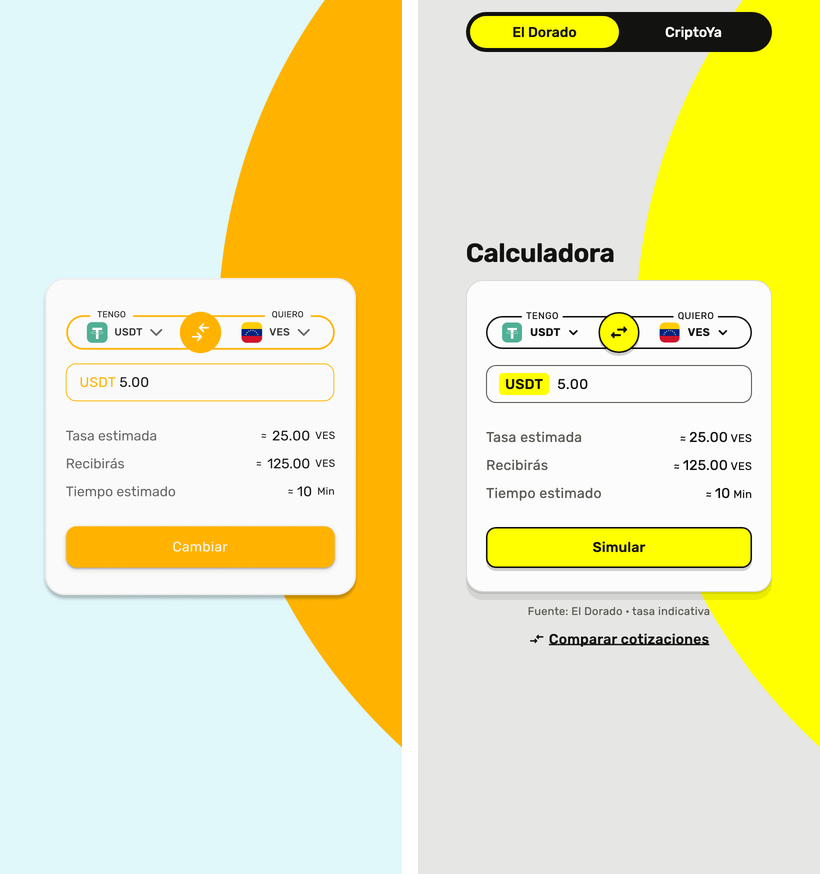
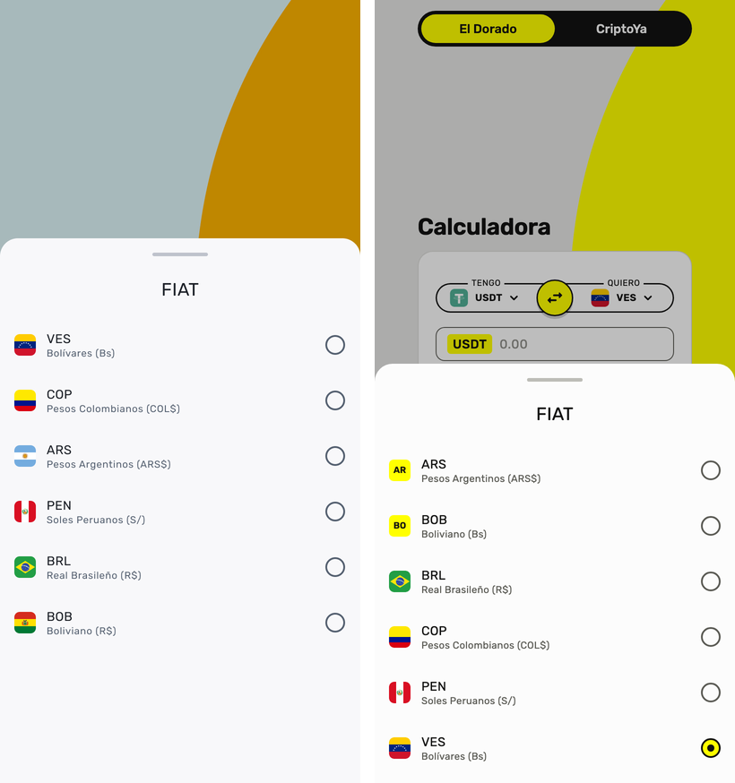
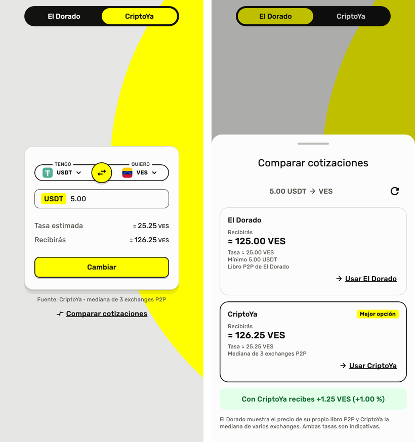

# Calculadora de cambio: El Dorado y CriptoYa

Mini-app en Flutter que calcula cuánto recibes al cambiar un monto entre una crypto (USDT, USDC) y una fiat (VES, COP, ARS, PEN, BRL, BOB). Tiene dos pestañas, cada una con su propia fuente de tasas:

- **El Dorado:** el API público oficial (`api.eldorado.io/api/prices`), con el precio de su libro P2P.
- **CriptoYa:** la mediana de los exchanges P2P que agrega.

Una tercera función compara las dos cotizaciones lado a lado.

| Mock del diseño (izquierda) y app (derecha) | Selector FIAT: mock y app |
|---|---|
|  |  |



La estructura, las medidas y la tipografía (Rubik) se midieron sobre los mocks. La paleta es la de **El Dorado**, tomada de las variables CSS de eldorado.io: amarillo `#FFFF00` como relleno con texto en tinta, que es como la usa la marca ([DESIGN_SYSTEM.md](DESIGN_SYSTEM.md)).

## Qué hace

- **Calculadora:** selector TENGO / QUIERO con botón de intercambio, monto con hasta 2 decimales, tasa estimada, monto a recibir y tiempo estimado. "Cambiar" es una confirmación simulada.
- **Dos fuentes, misma calculadora:** cada pestaña conserva su par y su monto. Las tasas se cachean (60 s en El Dorado, 30 s por par en CriptoYa), así que escribir no genera peticiones.
- **Comparación:** las dos cotizaciones para el mismo par y monto, la "Mejor opción" y la diferencia ("Con CriptoYa recibes +1.25 VES (+1.00 %)"). "Usar …" lleva a esa pestaña con el mismo par y monto.
- **Estados cuidados:**
  - Monto bajo el mínimo de El Dorado.
  - Pares que El Dorado no cotiza (USDC, compra de USDT con VES): aparecen deshabilitados en sus selectores y ofrecen "Ver en CriptoYa".
  - Sin ofertas, sin conexión, límite de consultas: cada uno con su mensaje y reintento.
  - Carga con skeletons y el valor anterior atenuado.
- **Accesibilidad:** contraste WCAG AA verificado por pruebas; etiquetas de lector de pantalla en los controles y los valores; sin desbordes con texto al 130 % en pantallas de 320 pt.

## Cómo ejecutar

Requisitos: Flutter 3.41 (Dart 3.11).

```bash
flutter pub get
flutter run                                    # APIs reales: El Dorado y CriptoYa
flutter run --dart-define=USE_MOCK=true        # sin red, con datos del mock
```

### Configuración (`--dart-define`)

| Clave | Default | Uso |
|---|---|---|
| `USE_MOCK` | `false` | `true`: un mock en el borde HTTP responde por cada API, con su forma real |
| `MOCK_SCENARIO_ELDORADO` | `success` | `empty`, `server_error`, `timeout`, `malformed` |
| `MOCK_SCENARIO_CRIPTOYA` | `success` | `no_offers`, `rate_limited`, `server_error`, `timeout`, `malformed` |
| `MOCK_LATENCY_MS` | `600` | Latencia simulada |
| `ELDORADO_API_URL` / `CRIPTOYA_API_URL` | APIs públicas | URL base de cada proveedor |
| `ELDORADO_SOURCE` | `prices` | `orderbook`: la pestaña El Dorado usa el API de órdenes del enunciado |
| `API_URL` | *(vacío)* | URL del endpoint `recommendations` (con `USE_MOCK=true` no hace falta) |

```bash
flutter run --dart-define=USE_MOCK=true --dart-define=MOCK_SCENARIO_CRIPTOYA=rate_limited
flutter run --dart-define=USE_MOCK=true --dart-define=MOCK_LATENCY_MS=2000
flutter run --dart-define=USE_MOCK=true --dart-define=ELDORADO_SOURCE=orderbook   # API de órdenes (mock)
```

### Pruebas

```bash
flutter analyze
flutter test                                               # unitarias, bloc y widgets, sin red
flutter test --dart-define=LIVE_TESTS=true --tags live     # contrato contra las APIs reales
flutter test --dart-define=GOLDENS=true --tags golden      # capturas a 402×874 pt (macOS)
```

Las pruebas `live` y los *goldens* no corren por defecto: unas dependen de la red y los otros del render de fuentes de cada sistema operativo.

## Arquitectura

Organizada por funcionalidad (`home`, `exchange`, `quote_comparison`), con capas `domain` / `data` / `presentation`. El detalle está en [ARCHITECTURE.md](ARCHITECTURE.md).

- **Dominio en Dart puro:** entidades, reglas de conversión con `Decimal` (nunca `double` para dinero), mínimo por proveedor y comparación.
- **Un repositorio por proveedor** (`RateProvider`). `ExchangeBloc` no sabe de qué proveedor es, así que cada pestaña es la misma calculadora con otra fuente. Sumar un proveedor agrega su pestaña y lo incluye en la comparación.
- **Mock en el borde HTTP** (interceptores de `dio`): en modo mock corre el mismo código de red, parseo, caché y errores que en producción.
- **Concurrencia:** todas las cotizaciones pasan por un único handler `restartable`, con el *debounce* adentro, así nunca se muestra una respuesta vieja.
- **Design system propio** ([DESIGN_SYSTEM.md](DESIGN_SYSTEM.md)): tokens semánticos como `ThemeExtension`, componentes `Ds*` y contraste verificado.
- **Textos en ARB** (es) y dependencias con `get_it` en un *composition root*.

Otros documentos: [IMPLEMENTATION_PLAN.md](IMPLEMENTATION_PLAN.md) (fases y notas de implementación) y [API_RESEARCH.md](API_RESEARCH.md) (evaluación de las APIs).

```
lib/
├── app/                 # App, composition root (get_it)
├── core/                # config, red, caché, errores, formateo, design system
├── features/
│   ├── exchange/        # calculadora: domain / data (eldorado, criptoya, orderbook) / presentation
│   ├── home/            # pestañas por proveedor
│   └── quote_comparison/
└── l10n/                # ARB y textos derivados del dominio
```

## Decisiones y limitaciones

- **El endpoint del enunciado ya no existe.** `…/stage/orderbook/public/recommendations` responde `404` (la ruta fue eliminada; el host sigue activo). Por eso la pestaña El Dorado usa el **API público oficial de El Dorado**.
  - El código para el endpoint original está implementado y probado contra su forma documentada y su mock: `--dart-define=ELDORADO_SOURCE=orderbook --dart-define=API_URL=<url>`. Falta verificarlo con una URL vigente.
  - La investigación completa está en [API_RESEARCH.md](API_RESEARCH.md).
- **Cobertura de El Dorado:** solo cotiza USDT; VES solo se puede vender. Esos pares se muestran como no disponibles, sin inventar tasas.
- **Precios indicativos:** El Dorado lo aclara en su documentación. CriptoYa es una mediana de mercado; la comparación lo explica en una nota.
- **Tiempo estimado:** `/api/prices` no lo informa, así que se muestra el del diseño (10 min). CriptoYa no aplica, y la fila se oculta.
- **Detalles del diseño:**
  - Las pestañas y la comparación no están en el diseño; se construyeron con sus tokens.
  - El sheet del diseño dice "Boliviano (R$)"; se usa el símbolo correcto, `Bs`.
- **Fuente Rubik empaquetada** (licencia OFL) para no depender de la red en tiempo de ejecución ni en las pruebas.

---

## Enunciado original

> Acá tienes todos los assets que necesitas para llevar a cabo una pequeña prueba técnica. El objetivo es que puedas demostrar tus habilidades de programación y de UI. El proyecto consiste de una pequeña calculadora que te muestra cuanto vas a recibir si quieres cambiar una determinada cantidad de una moneda a otra.

**Características**
1. Hay dos tipos de monedas: "FIAT" y "CRYPTO".
2. La tasa de cambio la podrás obtener de nuestro API público.
3. La moneda del input

**API**
- URL: https://74j6q7lg6a.execute-api.eu-west-1.amazonaws.com/stage/orderbook/public/recommendations
- Query params:
  - `type`: 0 -> Cambio de CRYPTO a FIAT, 1 -> Cambio de FIAT a CRYPTO
  - `cryptoCurrencyId`: La moneda crypto (el ID está en el nombre del asset)
  - `fiatCurrencyId`: La moneda fiat (el ID está en el nombre del asset)
  - `amount`: Cantidad a cambiar
  - `amountCurrencyId`: La moneda en la que está del input

Del response, simplemente obtener el `data.byPrice.fiatToCryptoExchangeRate` y multiplicarlo/dividirlo para mostrar toda la data necesaria.

**Qué puedes hacer**
- ✅ Preferiblemente, usa Flutter :)
- ✅ Cuantas mejoras de UX como veas necesarias/quieras
- ✅ No todo tiene que estar funcionando a la perfección, lo que más vamos a tomar en cuenta es el parecido con el diseño y la calidad del código.
- ✅ Desarrolla la app con la arquitectura de una app que va a escalar, no hagas un código que no puedas mantener en el futuro.

**Qué no puedes hacer**
- ❌ Estresarte 🤗

**Pasos para comenzar**
1. Haz un fork usando este repositorio como template
2. Clona el repositorio en tu máquina
3. Desarrolla la mini-app
4. Sube tus cambios a tu repositorio
5. Avísanos que has terminado
6. ???
7. PROFIT

Cualquier duda: https://www.linkedin.com/in/carlosfontest/
